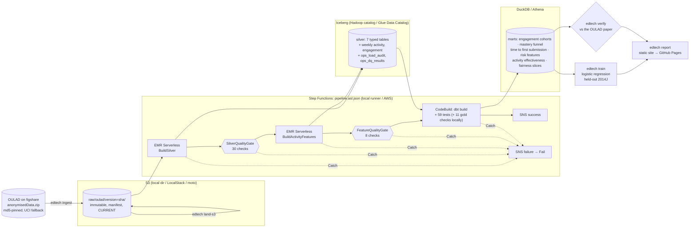

# EdTech learning analytics on AWS (OULAD)

[](https://github.com/rohit91jacob/edtech-learning-analytics-aws/actions/workflows/ci.yml)
[](https://github.com/rohit91jacob/edtech-learning-analytics-aws/actions/workflows/refresh.yml)
[](https://rohit91jacob.github.io/edtech-learning-analytics-aws/)
[](LICENSE)
[](DATA_LICENSE.md)


Mastery-learning analytics in the style of an EdTech product (engagement, an assessment
mastery funnel, time to first submission, withdrawal risk, which learning activities go with
passing, and outcome gaps by group), built as an AWS batch lakehouse:
**S3 → EMR Serverless (PySpark) → Apache Iceberg → dbt on Athena → Step Functions.**

* **Real data, honestly scoped.** Khan Academy's learner data is not public, so this project uses
  the **Open University Learning Analytics Dataset** (OULAD, CC BY 4.0): 32,593 student enrolments
  on 22 module presentations (2013–2014), their assessments, and 10,655,280 rows of daily VLE
  clickstream. It is downloaded at runtime from the figshare record cited by the paper.
* **Emulated cloud, real code paths.** Nothing here runs on AWS. The PySpark jobs that would run on
  EMR Serverless run locally with the same Spark and Iceberg versions as `emr-7.14.0`; the Iceberg
  Glue catalog is a local Hadoop catalog; DuckDB stands in for Athena under the same dbt project
  (which CI also compiles for Athena); and the **same Step Functions definition** that Terraform
  deploys is executed by a local runner. S3 code is tested against moto, and against LocalStack
  in CI.
* **Verified.** Every table's row count and the paper's module table (Kuzilek et al., 2017, Table 1)
  match exactly: 17 of 20 checks match, and the other 3 are places where the published sources
  contradict the data or each other, explained in [verification](docs/verification.md).
* **Gated.** 30 silver and 8 feature checks in Spark, 59 dbt tests and 11 gold reconciliation
  checks. Error-level failures stop the state machine before anything downstream runs (exit 3).
* **A baseline model, evaluated honestly.** Logistic regression for withdrawal risk at course day
  28, trained on 15 presentations and scored only on the 7 held-out 2014J presentations:
  **ROC AUC 0.669** (95% bootstrap CI 0.654–0.681) against 0.591 for a clicks-only baseline, with
  per-module and fairness-slice metrics. It is modest, and the site says so.

The weekly `refresh` workflow rebuilds everything from the public download and publishes the
results site: **[rohit91jacob.github.io/edtech-learning-analytics-aws](https://rohit91jacob.github.io/edtech-learning-analytics-aws/)**.

## Architecture



| Component | Code | What it does |
|---|---|---|
| Ingest | `ingest/landing.py` | Downloads the archive (retries, md5 check, UCI fallback), checks every header, lands it content-addressed with a manifest that records the URL it really came from; `CURRENT` is written last. Downloaded data is always verified strictly. Reruns are no-ops. |
| S3 landing | `ingest/s3.py` | Mirrors the raw version to a bucket with SSE-KMS; skips objects whose sha256 is already there. Tested on moto and LocalStack. |
| Silver job | `spark/silver.py` | Reads every column as a string, normalises both missing-value encodings, casts explicitly and **counts** cast failures, writes Iceberg v2 (zstd) tables atomically. |
| Features job | `spark/features.py` | Aggregates the 10.6M-row clickstream to enrolment × week (× activity type) so the warehouse never scans the raw clicks. |
| Spark DQ | `spark/dq.py` | Keys, domains, referential integrity, ranges, exact click reconciliation. Results appended to `ops_dq_results`; errors exit 3. |
| Spark entry point | `spark/job.py` | One CLI for every step; the Step Functions `EntryPointArguments` call it. Python 3.9-compatible for the EMR 7.x image. |
| dbt | `dbt/` | Staging → intermediate → 8 marts, 59 tests, cross-database macros (DuckDB `quantile_cont` / Athena `approx_percentile`, safe division). |
| Gold DQ | `quality/gold.py` | Reconciles marts with each other and with silver. |
| Orchestration | `orchestration/pipeline.asl.json`, `local_runner.py` | One ASL file: Terraform renders it into the real state machine; the local runner walks the same states, `Catch`es and failure path. |
| Model | `model/risk.py` | Logistic regression, temporal hold-out, bootstrap CI, clicks-only baseline, slice metrics; no protected attributes as inputs. |
| Verification | `verify.py` | 20 checks against the paper and the UCI description file. |
| Results site | `report/site.py` | Plain HTML and inline SVG generated from the marts (no JavaScript, no external assets). |
| EMR packaging | `aws/emr_package.py` | Reproducible `job.py` + `edtech_spark.zip` (`--py-files`). |
| Infrastructure | `infra/` | Terraform modules: storage + KMS, Glue + Athena, EMR Serverless + job role, Step Functions + CodeBuild + SNS + schedule + alarm, budget, GitHub OIDC deploy role. |

## Tech stack

All Python dependencies are pinned in `uv.lock`.

| Layer | Technology | Version |
|---|---|---|
| Language | Python | 3.12 (Spark job modules also compile on 3.9, the EMR 7.x runtime) |
| Batch processing | Apache Spark (PySpark) | 3.5.8 (= `emr-7.14.0`) |
| Table format | Apache Iceberg (`iceberg-spark-runtime-3.5_2.12`) | 1.10.1 (= `emr-7.14.0`) |
| JVM | Temurin / OpenJDK | 17 |
| Warehouse (local Athena stand-in) | DuckDB + `iceberg` extension | 1.5.6 |
| Transformations | dbt-core, dbt-duckdb, dbt-athena (compile only) | 1.12.5, 1.11.0, 1.11.1 |
| Model | scikit-learn, pandas | 1.9.1, 3.0.6 |
| AWS SDK / emulators | boto3, moto (tests), LocalStack (CI) | 1.43, 5.2, 4.14.0 |
| Infrastructure | Terraform, AWS provider, tflint, checkov | 1.16.5, ~> 6.68, 0.64.0, 3.3.26 |
| Packaging | uv, hatchling | 0.10 |
| Quality tooling | pytest 9, ruff 0.16, sqlglot (Trino parse check), pre-commit, gitleaks, Dependabot | |

## Design rationale

Six constraints shaped the design. The data had to be real and public: Khan Academy's learner
data is not public and the ASSISTments terms forbid sharing ([DATA_LICENSE.md](DATA_LICENSE.md)),
so the project uses OULAD, a static 2013–2014 release under CC BY 4.0, a licence that also lets a
real 288-student sample be committed as the test fixtures. Everything has to run and be checked
without an AWS account: nothing is deployed, so every AWS service has a local stand-in, the Spark
jobs run at the versions `emr-7.14.0` ships, and the Terraform is validated, not applied. The
weekly refresh has to run on free GitHub-hosted runners with no credentials. The development
machine has no Docker, so LocalStack runs only in CI. A deployed run has to stay cheap: a USD 25
monthly budget, an EMR capacity ceiling and a 10 GiB Athena scan cap. And every published number
has to be reproducible and checkable: a rerun must produce identical tables, and the figures must
reconcile with the dataset's paper. The data itself is small (a 47 MB archive; a clean full run
took 11 min 42 s on a laptop), so the Spark layer is there for the shape a production clickstream
would need, not because OULAD needs it.

### Architecture decisions

| Decision | Why | Alternatives considered | Trade-off accepted |
|---|---|---|---|
| **Version-matched local stand-ins for every AWS service** (`config.py`, `spark/session.py`, `dbt/profiles.yml`) | With nothing deployed, the AWS code paths are tested by running the same code locally. PySpark 3.5.8 and Iceberg 1.10.1 are the pair `emr-7.14.0` ships; `--catalog glue` moves the same `lake.<namespace>.<table>` names from a Hadoop catalog to Glue with `S3FileIO`; one dbt project targets DuckDB or Athena. The Spark modules stay Python 3.9-compatible and depend only on PySpark and the standard library (both unit-tested), so they ship to EMR as a plain `--py-files` zip. | Testing in a real account; LocalStack for every service (the community edition has no EMR Serverless); local versions chosen independently of EMR. | The stand-ins prove the code paths, not AWS behaviour: IAM, EMR sizing and Athena semantics stay untested. Dependabot skips pyspark, which moves only with the EMR release label. |
| **Immutable, content-addressed raw zone; `CURRENT` written last** (`ingest/landing.py`, `ingest/s3.py`) | Headers are checked against the published column order before anything lands. The version name is a hash of every file's sha256, so a rerun on the same archive is a no-op and a changed archive becomes a new version instead of an overwrite. Each version is staged under a temporary name and renamed into place with a manifest (source URL, licence, row counts, hashes), and Spark reads only the version `CURRENT` names. The S3 mirror skips objects whose sha256 metadata already matches and also writes `CURRENT` last. | Overwriting a fixed `raw/` prefix or a run-date partition; converting to Parquet on landing. | Raw CSV and Iceberg copies both exist, and superseded raw versions stay until removed by hand. |
| **Text in, explicit casts, failures counted** (`spark/silver.py`) | With ANSI mode off (Spark 3.5's default) a value that does not parse casts to NULL without an error, and the two mirrors encode missing values differently (`""` on figshare, `"?"` on UCI). Silver reads every column as a string in `FAILFAST` mode, normalises both encodings to NULL, casts explicitly and writes cast failures and raw-vs-silver row counts to `ops_load_audit`, which two error-level checks gate. | `inferSchema`; a typed read schema; `PERMISSIVE` mode with a corrupt-record column. | Columns and types are declared by hand, in two places (`oulad.py` for ingest, `spark/silver.py` for Spark), because the EMR zip carries only the `spark` package. |
| **Clickstream aggregated once in Spark; dbt never reads raw clicks** (`spark/features.py`, `dbt/models/staging/_sources.yml`) | The 10.66M-row `student_vle` is the only heavy table. Spark rolls it up to enrolment × week × activity type (2.52M rows) and enrolment × week (627k), and those are the only clickstream sources dbt declares, so the marts stay cheap on Athena (billed by bytes scanned) and on DuckDB. The feature gate checks that weekly clicks and row counts sum exactly to the clickstream. | dbt models over `student_vle`; one Spark job that also builds the marts. | dbt sees nothing finer than the course week, so a new clickstream measure needs a Spark change. The engagement table is recomputed from the clicks, not summed from the activity table (distinct days and sites do not add up), so the job scans the clickstream twice. |
| **Full rebuild every run, one atomic replace per table** (`spark/silver.py`, `spark/features.py`, `dbt/dbt_project.yml`) | OULAD is static and a full run takes minutes, so there is no increment to process. Each silver and feature table is replaced with `createOrReplace` (one Iceberg snapshot per table per run) from deterministic input, and every dbt model is a view or a table rebuilt from silver, so a rerun leaves every silver data table and mart with identical contents (`test_rerun_is_idempotent` compares content hashes). Only `ops_dq_results` is appended, so it keeps every run's check results. | Iceberg `MERGE INTO` on business keys; dbt incremental models; append plus downstream dedupe. | Cost grows with the whole dataset, not with new data. Tables commit one at a time, so a run that fails midway can leave silver tables from two raw versions side by side until the next successful run; the failed execution stops before dbt. |
| **Quality gates are states that stop the run** (`spark/dq.py`, `quality/gold.py`) | 30 silver and 8 feature checks run as their own EMR job runs between the build steps, dbt's 59 tests run inside `dbt build`, and locally 11 gold checks reconcile the marts with each other and with silver. An error-level Spark or gold check exits 3 and a failing dbt test fails the build; either way the state fails and `Catch` routes to `NotifyFailure` and `PipelineFailed`, so nothing downstream runs (an end-to-end test corrupts a score and checks that dbt never starts). Warnings, such as the 1,111 enrolments without an IMD band, are recorded in `ops_dq_results` without blocking. | dbt tests only; Great Expectations, Soda or Deequ; alerting without blocking. | One failed error-level check blocks the whole refresh, site included. Each gate is a separate EMR job run, so on AWS it waits for workers again (no pre-initialised capacity). The Python gold checks run only on DuckDB; on AWS, dbt's tests are the warehouse gate. |
| **One Step Functions definition, two executors** (`orchestration/pipeline.asl.json`, `orchestration/local_runner.py`) | Terraform renders the file with `templatefile()` into the real state machine; `edtech run` renders the same file with local values and walks its states, `Catch`es and failure path, mapping the EMR, CodeBuild and SNS tasks to local executors. A unit test fails if Terraform stops supplying a placeholder the file uses, moto accepts the rendered definition, and CI runs its failure path on LocalStack. | A Makefile or script locally plus a cloud workflow kept in step by hand; Airflow DAGs on MWAA. | The local runner supports only Task, Succeed and Fail states, and the EMR `Retry` blocks never fire locally. Locally the CodeBuild state is dbt on DuckDB plus the gold checks, not the buildspec. |
| **Reconcile with figures published outside the repo** (`verify.py`) | The gates prove that the layers agree with each other, not that the numbers are right. 20 checks compare silver and the marts with the paper's row counts and Table 1 and with the UCI description file. Any downloaded archive is verified strictly, so a truncated or altered download fails with exit 4 instead of passing as a sample. | Internal reconciliation only; trusting the md5 pin alone (the UCI fallback has none). | Three published figures contradict the data or each other and are recorded as documented mismatches ([verification](docs/verification.md)). The model has no published benchmark to check against. |
| **A leakage-guarded baseline on a temporal hold-out** (`model/risk.py`, `dbt/models/marts/mart_dropout_risk_features.sql`) | A random split would leak presentation-level effects, so the model trains on 15 presentations and is scored only on the 7 held-out 2014J ones. Features use course weeks before the day-28 cut-off week and submissions before day 28, and students who had already left are excluded. Gender, region, age band, IMD band and disability are kept out of the inputs; the last three slice the evaluation. Results sit next to a clicks-only baseline, with a seeded bootstrap CI. | A random or stratified split; a higher-capacity learner such as gradient-boosted trees; demographics as features. | A modest AUC (0.669), weak for some modules (GGG 0.512), and it under-predicts risk for students declaring a disability. |

### Stack choices

| Layer | Choice | Why this | Why not the alternatives |
|---|---|---|---|
| Language | Python 3.12 (`>=3.12,<3.13`); the Spark modules stay 3.9-compatible | Every tool here (PySpark, dbt, DuckDB, scikit-learn, boto3, moto) has a Python API, so one `edtech` CLI drives every pipeline step and dbt runs in-process through `dbtRunner`. CI compiles the Spark modules on Python 3.9, the EMR 7.x runtime. | Scala for the Spark jobs: a second language and build tool for jobs that are mostly DataFrame aggregations, while dbt, the model and the tests stay in Python. |
| Batch compute | PySpark 3.5.8 on Java 17 (Temurin), `local[*]`; EMR Serverless `emr-7.14.0` on ARM64 on AWS | EMR Serverless runs Spark with no cluster to manage: workers start on demand, the application stops after 10 idle minutes, and a hard 16 vCPU / 64 GB ceiling caps all runs together, all set in Terraform. The same job file runs under `local[*]` at that release's versions. | DuckDB alone would handle 10.66M rows on one machine; Spark is here so the same job scales out on a much larger clickstream. EMR on EC2: a cluster to size and stop. AWS Glue jobs: also serverless Spark and a reasonable choice; EMR Serverless gives one capacity-capped, auto-stopping application on ARM64 workers. |
| Table format and catalog | Apache Iceberg 1.10.1 (format v2, zstd Parquet); Hadoop catalog locally, Glue Data Catalog on AWS | `createOrReplace` is an atomic commit, so each rebuild is one snapshot per table. Spark writes Iceberg, DuckDB's `iceberg` extension reads it in place, and Athena engine v3 and dbt-athena (`+table_type: iceberg`) read and write it natively, so silver and the marts share one format on AWS. The Hadoop catalog needs no server. | Delta Lake: dbt-athena's SQL models materialise Hive or Iceberg tables, not Delta. Plain Parquet folders and a crawler: no atomic replace or snapshots. A REST catalog or Hive metastore: one more service locally and in CI. |
| Warehouse | DuckDB 1.5.6 with the `iceberg` extension locally; Athena engine v3 on AWS | DuckDB is in-process: dbt-duckdb builds the marts into one file straight from the silver Iceberg tables, and the model, verification and site read that file. Athena is serverless and billed per TB scanned, and the workgroup enforces KMS-encrypted results and a 10 GiB per-query cap. | Redshift, serverless or provisioned: capacity to configure for builds that read under 100 MB. Trino in a container as the local stand-in: closer to Athena's engine, but Docker and a JVM service; CI parses the compiled Athena SQL as Trino instead. |
| Transformations | dbt-core 1.12.5; dbt-duckdb 1.11.0 (`dev`), dbt-athena 1.11.1 (`athena`, compile only) | One SQL project with tests and lineage for both engines. `dbt/macros/cross_db.sql` dispatches the differences (exact `quantile_cont` against `approx_percentile`), `generate_schema_name` gives each schema its own Glue database on Athena, and the generic tests live in the repo, so `dbt deps` is never needed. CI compiles the Athena target with every AWS endpoint pointed at a closed local port and parses the output as Trino (`scripts/check_athena_sql.py`). | Hand-written SQL per engine: no DAG or tests, and two copies to keep in step. Marts built in Spark: an EMR job run for every mart change, where Athena queries the same Iceberg tables serverless. |
| Orchestration | AWS Step Functions (Standard) with `.sync` integrations for EMR Serverless and CodeBuild; SNS; EventBridge Scheduler, disabled by default | One JSON file holds the order, retries, `Catch` and the SNS failure path, and the local runner can execute it. `.sync` tasks wait for the EMR job or the dbt build to finish with no polling code; Standard workflows bill per state transition, so an idle state machine costs nothing; dbt runs as a CodeBuild build, so no server hosts it. | Amazon MWAA (Airflow): an environment billed by the hour for a pipeline that runs at most weekly. dbt on Lambda: a 15-minute limit and dbt packaged for Lambda. A cron job on EC2: a server to patch and pay for between runs. |
| Model | scikit-learn 1.9.1 (logistic regression), pandas 3.0.6 | Coefficients on standardised features that the site publishes, training inside the pipeline on 18,334 rows, and a seeded bootstrap over a stably ordered input, so the report is reproducible. pandas carries the feature frame from DuckDB into scikit-learn. | Gradient-boosted trees or a neural network: more capacity, less transparency, for a baseline meant to show what the features carry. SageMaker: a managed service to deploy for a model trained on one machine. |
| AWS SDK and emulators | boto3 1.43.110; moto 5.2.3 (unit tests); LocalStack 4.14.0 (CI only) | moto runs in-process with no Docker and covers S3, KMS and Step Functions. LocalStack gives CI a second, independent emulator for the S3 landing and a real ASL interpreter for the failure path. | Real AWS in CI: an account, credentials and a bill per push. LocalStack alone: Docker on the development machine; 4.14.0 is pinned by digest as the last community release that needs no auth token. |
| Infrastructure as code | Terraform 1.16.5, hashicorp/aws 6.68.0 (`~> 6.68`), tflint 0.64.0, checkov 3.3.26 | Seven small modules under one root (`s3_bucket`, `storage`, `catalog`, `emr_serverless`, `orchestration`, `guardrails`, `github_oidc`), with `templatefile()` rendering the shared ASL file. CI checks it all without an account: `fmt`, `validate` after `init -backend=false`, tflint with the `all` preset, and checkov with every skip justified inline. The S3 backend with native locking is ready to uncomment in `infra/versions.tf`. | AWS CDK: the CLI needs Node.js, and an offline check means synthesising CloudFormation first. |
| CI/CD and auth | GitHub Actions (every action pinned by commit SHA), GitHub Pages, a GitHub OIDC deploy role | Free for a public repository. The refresh needs no secrets: the source is public and Pages deploys with the built-in `GITHUB_TOKEN`. `deploy.yml` does nothing until `AWS_DEPLOY_ROLE_ARN` is set, then assumes a role that only the `aws-dev` environment can use and that can only upload artefacts, land raw data and start the pipeline; infrastructure stays with a human running `terraform apply`. | IAM user access keys in repository secrets: long-lived and in need of rotation. CodePipeline: an AWS account before any CI could run. |
| Results site | Static HTML, CSS and inline SVG generated in Python (`report/site.py`) | Every number is read at build time from the marts, the `ml` tables, the DQ results, the raw manifest and `ops/verification.json`; with no JavaScript or external assets, GitHub Pages serves it as is. | QuickSight, Superset or Metabase: a running service and logins for a page rebuilt once a week. A JavaScript charting library: a dependency and a bundle for one line chart and some tables. |
| Packaging and quality | uv 0.10 (`uv.lock`), hatchling, ruff 0.16.10, pytest 9.1.1, sqlglot 30.21.0, pre-commit 4.6.2 with gitleaks 8.30.1, Dependabot | `uv sync --frozen` installs the locked versions on the laptop, in CI and in CodeBuild, and `uv lock --check` fails CI if the lock drifts. ruff lints and formats with a Python 3.9 target for the Spark modules, pytest markers (`spark`, `e2e`, `localstack`) separate the slow suites, and Dependabot groups minor and patch updates weekly. | pip-tools or Poetry would work; uv is faster and also supplies the Python 3.9 interpreter for CI's compile check. flake8, black and isort: three tools for what ruff does. |

### What would change in production

* **A real account, with the untested parts exercised.** Nothing here is deployed (see
  [Limitations](#limitations)). A first deployment follows the
  [runbook](docs/runbook.md#deploying-to-aws): an S3 state backend, the `project` cost-allocation
  tag the budget filters on, a human `terraform apply`, then `deploy.yml` to upload the job zip and
  dbt bundle, land OULAD and start the state machine. Only that run shows whether the IAM policies
  are complete, the EMR sizing holds and the Athena SQL behaves as compiled; medians become
  approximate (`approx_percentile`), and an account that enforces Lake Formation on the Glue
  catalog needs grants as well.
* **The whole pipeline in the state machine.** On AWS the state machine ends with
  `DbtBuildAndTest` and its success notification: the model, verification and site run only in
  `edtech pipeline`, after the state machine and against the local DuckDB file, and the gold
  checks are DuckDB-only. A deployment would add states for them (CodeBuild builds reading the
  Athena marts, for example) and port the gold checks to dbt singular tests, so the warehouse gate
  on Athena is as strict as the local one.
* **Incremental loads for a live clickstream.** A full rebuild suits a static release. A product
  whose clickstream arrives daily would land each delivery as its own batch, `MERGE` or overwrite
  only the partitions a delivery touches (the clickstream tables are partitioned by module and
  presentation; a live feed would add an event date), make the largest marts incremental, and
  enable the EventBridge schedule at the delivery cadence.
* **Capacity sized for the data.** The 16 vCPU / 64 GB ceiling, at most 3 executors of 4 cores and
  8 GB, and the 10 GiB Athena cap are set for a 10.66M-row clickstream. A larger clickstream would
  raise them, and pre-initialised EMR capacity would cut the gate jobs' start-up wait at the price
  of paying for idle workers.
* **Controls for identifiable learner data.** OULAD is public and anonymised, with demographics
  generalised for k-anonymity, and the Terraform tags every resource
  `data-classification = "public-anonymised"`. Real learner records would need Lake Formation
  grants that keep demographic columns from most readers, CloudTrail data events on the lake
  bucket, and a fairness review before any risk score informs a decision about a learner (this
  baseline is not fit for that).

## Data sources

| Source | What | Licence | Refresh cadence | Used? |
|---|---|---|---|---|
| [OULAD](https://doi.org/10.6084/m9.figshare.5081998.v1) (figshare; [UCI mirror](https://archive.ics.uci.edu/dataset/349/open+university+learning+analytics+dataset)) | 7 CSV tables: courses, assessments, VLE materials, student info, registrations, assessment results, daily VLE clicks | CC BY 4.0 | **Static.** Released 2015 (files dated 2015), figshare record 2017; the archive is md5-pinned | Yes, primary |
| ASSISTments (WPI) | tutoring logs | Terms forbid sharing ("I agree to not give this data to anyone else") and require a written agreement | – | No, see [DATA_LICENSE.md](DATA_LICENSE.md) |
| Khan Academy | – | Not public | – | No |

**Known gaps and quirks in OULAD** (all handled and documented): 11 exams have no date; 18 of 24
exams have no results in the release; 1,111 enrolments have no IMD band; one IMD band is spelled
`10-20` instead of `10-20%`; 93 withdrawn enrolments have no unregistration day and 9 unregistered
ones are not `Withdrawn`; 56 non-exam assessments carry 0% weight; demographics were generalised
for k-anonymity (k = 5), so bands are coarse; the OU's own download link now returns 404.

## Data model

| Layer | Tables (grain) |
|---|---|
| Raw | 7 CSV files per content-addressed version, `_manifest.json`, `CURRENT` |
| Silver (Iceberg) | `courses` (presentation), `assessments` (assessment), `vle_sites` (material), `students`, `registrations` (enrolment), `student_assessments` (result), `student_vle` (daily clicks; 10.66M), `student_weekly_activity` (enrolment × week × activity type; 2.52M), `student_weekly_engagement` (enrolment × week; 627k), `ops_load_audit`, `ops_dq_results` |
| Staging / intermediate (dbt) | `stg_oulad__*` views; `int_enrolments`, `int_assessment_submissions`, `int_enrolment_activity` |
| Marts (dbt) | `dim_module_presentation`, `mart_engagement_weekly_cohorts`, `mart_assessment_mastery_funnel`, `fct_first_submission`, `mart_time_to_first_submission`, `mart_dropout_risk_features`, `mart_vle_activity_effectiveness`, `mart_outcome_fairness_slices` |
| ML (DuckDB `ml`) | `risk_model_metrics`, `risk_model_slices`, `risk_model_per_module`, `risk_model_coefficients` |

Columns and definitions (active week, pass mark, "mastered", cohorts, leakage guards) are in the
**[data dictionary](docs/data_dictionary.md)**.

## What the data shows (full release, local run of 9 October 2026)

* **Engagement separates outcomes from week 0.** 51.5% of students who later withdraw click in the
  VLE in the first course week, against 86.5% of those who pass and 89.8% with distinction.
* **Mastery funnel.** On the first graded assessment of each presentation, 30,059 enrolled →
  22,640 submitted (75.3%) → 21,786 passed → 15,293 scored 70 or more.
* **Time to first submission.** 54.9% of students who withdraw never submit anything; among those
  who pass, 0.1%.
* **Outcome gaps.** Pass rate is 35.2% in the most deprived IMD decile and 57.5% in the least
  deprived; 38.1% for students declaring a disability against 48.2% for those who do not. These
  are descriptive gaps, confounded with module choice and study load, not causal estimates.
* **Model fairness.** On the held-out presentations the model's AUC is similar across disability
  groups (0.661 vs 0.669), but it under-predicts risk for students declaring a disability (mean
  predicted 21.3% vs an actual 27.4% withdrawal rate).

## Quickstart

### Prerequisites

* Python 3.12 and [uv](https://docs.astral.sh/uv/)
* Java 17 for the Spark steps, on Linux, macOS or WSL2 (native Windows Spark needs Hadoop's
  `winutils.exe`; this project was developed with the Spark steps in WSL2 Ubuntu)
* Internet access to figshare (47 MB archive), Maven Central (47 MB Iceberg jar) and the DuckDB
  extension repository (`iceberg` extension), all on first run only
* About 4 GB of free RAM and 1 GB of disk for the full release

### Run it

```bash
git clone https://github.com/rohit91jacob/edtech-learning-analytics-aws.git
cd edtech-learning-analytics-aws
uv sync --frozen --all-extras

make pipeline-fixtures   # the committed 288-student sample: 2-6 minutes
make pipeline            # the full release: download, Spark, dbt, model, verification, site
open site/index.html
```

A clean full run (archive already downloaded; raw zone, warehouse and marts rebuilt from scratch)
took **11 min 42 s** on a 12-core laptop in WSL2 (Ubuntu, Spark `local[*]`, 4 GB driver, data on the
Linux filesystem); downloading the archive from figshare added about 6 minutes on that network. A rerun on an existing warehouse produces identical
tables. Exit codes: `0` ok, `1` failure, `2` configuration, `3` data-quality gate, `4`
verification mismatch.

```console
$ uv run edtech train
{
  "holdout_presentation": "2014J",
  "train_rows": 18334,
  "test_rows": 9219,
  "train_auc": 0.716,
  "test_auc": 0.669,
  "test_auc_ci95": [0.654, 0.681],
  "baseline_clicks_only_test_auc": 0.591,
  "test_average_precision": 0.323
}
```

(Values rounded here; the command prints full precision.) `make help` lists every target;
`edtech --help` every command.

## Local emulator → real AWS service

| Concern | Local / CI (what actually ran) | Real AWS (Terraform in `infra/`, validated, not deployed) |
|---|---|---|
| Object storage | Filesystem under `EDTECH_DATA_DIR`; moto in unit tests; LocalStack S3 in CI | S3 buckets (raw, lake, code, Athena results, access logs), SSE-KMS, versioning, TLS-only policies |
| Spark compute | PySpark 3.5.8 `local[*]` | EMR Serverless application, `emr-7.14.0`, ARM64, capped at 16 vCPU / 64 GB, auto-stop after 10 idle minutes |
| Table catalog | Iceberg Hadoop catalog on disk | Iceberg `GlueCatalog` + `S3FileIO` (same code, `--catalog glue`) |
| SQL warehouse | DuckDB reading Iceberg with `iceberg_scan` | Athena engine v3 workgroup (enforced config, KMS results, 10 GiB per-query scan cap) |
| dbt | `dbt build --target dev` (DuckDB) | `dbt build --target athena` in CodeBuild; CI compiles this target offline and parses every model as Trino SQL |
| Orchestration | `local_runner.py` executing `pipeline.asl.json` | Step Functions (`emr-serverless:startJobRun.sync`, `codebuild:startBuild.sync`, `sns:publish`), X-Ray, full logging, KMS; CI also creates and runs it on LocalStack (failure path) and moto |
| Scheduling | GitHub Actions `refresh.yml`, weekly | EventBridge Scheduler, weekly, **disabled** by default |
| Alerting | Failure issue opened by `refresh.yml` | SNS topic (KMS) + CloudWatch alarm on `ExecutionsFailed` |
| Cost guardrails | – | AWS Budget on the `project` tag (alerts at 80% actual, 100% forecast), EMR max capacity, Athena scan cap, lifecycle rules |
| CI/CD auth | – | GitHub OIDC role (upload artefacts, land raw data, start the pipeline only); `deploy.yml` is a no-op unless `AWS_DEPLOY_ROLE_ARN` is set |

## Cost notes

Not measured: nothing was deployed. Order-of-magnitude reasoning for one full run in `eu-west-2`:
the Spark work took a few minutes on one laptop, so EMR Serverless should need a few vCPU-hours
at most (EMR Serverless bills per vCPU-second and GB-second, ARM64 cheaper than x86); Athena bills
per TB scanned, and the marts read under 100 MB of Iceberg data per build (81 MB for the whole
local warehouse); S3 holds well under 1 GB. The guardrails are therefore set low: a USD 25 monthly
budget, an EMR capacity ceiling and a 10 GiB per-query Athena cap. Check the current AWS price
pages before deploying.

## Testing and CI

```bash
uv run pytest tests/unit     # 39 tests, no JVM (ingest, moto S3/KMS/Step Functions, ASL, packaging)
uv run pytest tests/spark    # 11 tests (about 13 minutes): Spark + Iceberg + dbt end to end on the fixtures
```

The end-to-end tests run the whole state machine on the fixtures, then check that silver
reconciles with the raw files, every gate passed, the model, verification and site run, a full
**rerun leaves every silver table and mart byte-identical** (content hashes), and that a corrupted
input (an impossible score plus a duplicate result, or an unknown `final_result`) is stopped by the
silver gate with exit 3 before dbt runs.

| Workflow | Trigger | What it does |
|---|---|---|
| [`ci.yml`](.github/workflows/ci.yml) | push, PR | `lint` (lockfile, ruff, Python 3.9 compile of the Spark modules, gitleaks, 300 KB file limit) · `unit` · `pipeline` (Spark + dbt tests, CLI pipeline on fixtures, dbt rebuild, EMR artefacts) · `dbt-athena` (offline compile + Trino parse) · `terraform` (fmt, validate, tflint, checkov) · `localstack` (S3 landing, Step Functions failure path) |
| [`refresh.yml`](.github/workflows/refresh.yml) | Mondays 05:17 UTC, manual | Full pipeline on the real download, site to GitHub Pages; a failing scheduled run opens an issue |
| [`keepalive.yml`](.github/workflows/keepalive.yml) | 1st and 15th | Re-enables the scheduled workflows so GitHub's 60-day rule never disables them |
| [`deploy.yml`](.github/workflows/deploy.yml) | manual | Only if `AWS_DEPLOY_ROLE_ARN` is set: OIDC login, upload artefacts, optionally land data and start the pipeline |

All actions are pinned by commit SHA. **The `localstack`, `pipeline` and Pages jobs need GitHub's
runners and were not run on the author's machine** (no Docker locally); everything they call was
run locally in WSL2, except the LocalStack test file itself.

## Project structure

```
├── src/edtech_analytics/
│   ├── cli.py, config.py, logs.py, oulad.py, pipeline.py, verify.py
│   ├── ingest/          # download + content-addressed landing; S3 mirror
│   ├── spark/           # EMR Serverless jobs (Python 3.9-compatible): session, silver, features, dq, job
│   ├── orchestration/   # pipeline.asl.json (shared with Terraform) + local runner
│   ├── quality/         # gold reconciliation checks
│   ├── transform/       # in-process dbt runner
│   ├── model/           # withdrawal-risk baseline
│   ├── report/          # static results site
│   └── aws/             # EMR artefact packaging
├── dbt/                 # staging / intermediate / marts, seeds, macros, singular tests
├── infra/               # Terraform root + modules (s3_bucket, storage, catalog, emr_serverless,
│                        #   orchestration, guardrails, github_oidc)
├── tests/               # unit/, spark/ (e2e), integration/ (LocalStack), fixtures/oulad/ (real, CC BY 4.0)
├── scripts/             # build_fixtures.py, check_athena_sql.py
├── docs/                # data_dictionary.md, runbook.md, verification.md
└── .github/             # ci, refresh, keepalive, deploy; Dependabot
```

## Limitations

* **Emulated, not deployed.** IAM policies, EMR sizing and Athena behaviour are untested against a
  real account. CI only compiles and parses the Athena SQL; percentile results on Athena would be
  approximate (`approx_percentile`).
* **Python gold checks are DuckDB-only.** On AWS, dbt's tests are the warehouse gate.
* **The model is a baseline.** AUC 0.669 on the held-out presentations; it is weak for some modules
  (GGG 0.512: it flags no GGG students at its threshold) and under-predicts risk for students
  declaring a disability. Do not use it for decisions about individuals.
* **Associations, not effects.** Activity-type "effectiveness" compares users with non-users among
  students who did not withdraw; engaged students use more of everything.
* **Static, historical data** from one UK distance-learning university in 2013–2014. It is not Khan
  Academy data and says nothing about Khan Academy learners.
* **Feature timing.** Scores count from their submission day, although marking happens later; the
  cut-off is rounded down to whole course weeks for clickstream features.

## License

Code: [MIT](LICENSE). Data: OULAD, © The Open University, [CC BY 4.0](https://creativecommons.org/licenses/by/4.0/);
see [DATA_LICENSE.md](DATA_LICENSE.md) for attribution.
